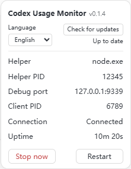

# Codex Usage Monitor

[简体中文](README.md) · [English](README.en.md)

[](https://github.com/Yang-goat/codex-usage-monitor/actions/workflows/check.yml)
[](https://github.com/Yang-goat/codex-usage-monitor/releases/latest)
[](LICENSE)

See token usage, context occupancy, and remaining account quota below the main composer in Codex and ChatGPT Work on Windows.

**[Download for Windows](https://github.com/Yang-goat/codex-usage-monitor/releases/latest)** · [Quick start](#quick-start) · [Report an issue](https://github.com/Yang-goat/codex-usage-monitor/issues/new/choose)


## What you can see

- **Tokens and cache** — Track cumulative usage and the input cache hit rate. Click the token count for input, output, reasoning, and cached input.
- **Context** — See tokens used, tokens left, and window size for the latest model call.
- **Account quota** — Track remaining quota and reset times. Local log snapshots can fill in when live quota is unavailable.
- **Compact settings** — Use the gear to switch languages, check for updates, or control the helper process. The language preference is saved locally.



The status bar image comes from the desktop client. The settings image uses sample data and shows the current source build. See [Releases](https://github.com/Yang-goat/codex-usage-monitor/releases/latest) for stable build features.

## Quick start

**Requirements** — Windows 10 or 11, the Codex desktop app with an active login, PowerShell 5.1 or later, and Node.js 22 or later. The optional Codex CLI provides live quota. The Windows ZIP runs from source and needs no npm dependencies.

1. Download the Windows ZIP and `SHA256SUMS.txt` from the [latest release](https://github.com/Yang-goat/codex-usage-monitor/releases/latest). Compare the ZIP hash with the published checksum.
2. Extract it to a directory you plan to keep. Open PowerShell in the extracted project directory.
3. Run the startup check and installer below. The installer wires up your desktop **Codex** shortcut and backs up an existing shortcut.
4. When your current tasks finish, fully quit Codex, including its tray instance. Start it from the desktop shortcut.

```powershell
# In the download directory, substitute your ZIP's actual filename.
Get-FileHash -Algorithm SHA256 .\codex-usage-monitor-v0.1.4-windows.zip
Get-Content .\SHA256SUMS.txt

# From the extracted project directory.
powershell.exe -NoProfile -ExecutionPolicy Bypass -File .\scripts\Start.ps1 -CheckOnly
powershell.exe -NoProfile -ExecutionPolicy Bypass -File .\scripts\Install.ps1
```

You can also clone the [repository](https://github.com/Yang-goat/codex-usage-monitor.git) and run the same scripts. The installer accepts `-ShortcutPath`, `-AppPath`, `-NodePath`, `-CliPath`, and `-Port`. Use a new shortcut path if the existing shortcut cannot be verified. The default debug endpoint is `127.0.0.1:9339`. Installer and launcher diagnostics are in Simplified Chinese.

## Using the monitor

- Open a main chat in Codex or ChatGPT Work. The monitor stays hidden in side chats, regular ChatGPT chats, and Dot. It also hides when the composer runs out of room.
- Click the token count or context metric for details and hover for the exact values. Press Esc or click outside to close a panel.
- Open the gear and choose **English** under **Language**. Update checks run when the helper starts, with a manual check in settings. A newer stable version comes with a link to its release page.
- **Stop now** and **Restart** control the helper. Fully quitting Codex also stops the helper.

Usage numbers update as local log events arrive. Chats without a local log may show `—`. Account quota is shared across chats on the same account.

## Updating and uninstalling

Fully quit Codex before updating and keep the existing installation's `runtime/` directory, which contains the shortcut backup and installation record.

- **Git** — Check `git status`, run `git pull --ff-only` in the existing directory, and run the installer again.
- **ZIP** — Uninstall from the old directory, verify and extract the new ZIP, and follow the quick start steps.
- **Uninstall** — The command below restores the original shortcut or removes the shortcut it created. It preserves shortcuts changed outside the installer and reports the conflict.

```powershell
powershell.exe -NoProfile -ExecutionPolicy Bypass -File .\scripts\Uninstall.ps1
```

## Troubleshooting

| Symptom | What to check |
| --- | --- |
| The monitor is missing | Use the linked desktop shortcut and open a main chat. Fully quit any tray instance before trying again. |
| Codex or Node is missing | Pass the actual desktop app or Node path using `-AppPath` or `-NodePath`. |
| Quota shows a snapshot or `—` | Check the optional Codex CLI, sign-in, and connectivity. Local token statistics can still be available. |
| The client updated and the layout changed | Run `Start.ps1 -CheckOnly` and check `hiddenReason` in `runtime/status.json`. |

## Privacy and compatibility

The monitor parses usage logs locally and displays numeric statistics. The helper asks the local Codex CLI for account quota and contacts GitHub for public release metadata. Keep the debug port on loopback. The installer leaves the Codex application package intact. Client updates can change the composer markup and require an adapter update.

## Contributing

Report issues with your Windows, Codex, and monitor versions and clear reproduction steps. Share screenshots with sensitive details removed. Keep runtime files, chat logs, and credentials private.

```powershell
npm.cmd test
npm.cmd run check:release
powershell.exe -NoProfile -ExecutionPolicy Bypass -File .\tests\scripts.test.ps1
npm.cmd run preview
```

The preview at `http://127.0.0.1:9841` uses sample data. See the [changelog](CHANGELOG.md) for release history. Run `npm.cmd run build:release` to package the committed Git source.

## Credits and license

A community project under the [MIT License](LICENSE). Inspired by [Codex-Monitor](https://github.com/KevinKE93/Codex-Monitor) and [Codex Token Overlay](https://github.com/soleillevant0125/codex-token-overlay). The quota integration uses the [OpenAI App Server](https://learn.chatgpt.com/docs/app-server).
