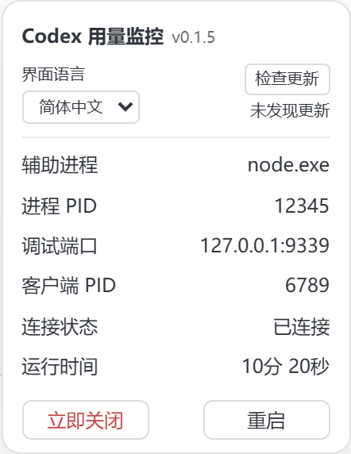

<h1 align="center">Codex 用量监控</h1>

<p align="center">
  <a href="README.md"><strong>简体中文</strong></a> · <a href="README.en.md">English</a>
</p>

<p align="center">
  <a href="https://github.com/Yang-goat/codex-usage-monitor/actions/workflows/check.yml"></a>
  <a href="https://github.com/Yang-goat/codex-usage-monitor/releases/latest"></a>
  <a href="LICENSE"></a>
</p>

<p align="center">
  在 Windows 版 Codex 和 ChatGPT Work 的主聊天输入框底部，随时查看 token、上下文占用和账号剩余额度。
</p>

<p align="center">
  <strong><a href="https://github.com/Yang-goat/codex-usage-monitor/releases/latest">下载 Windows 版</a></strong> · <a href="#快速安装">快速安装</a> · <a href="docs/AI_AGENT_SETUP.md">交给 AI Agent 安装</a> · <a href="https://github.com/Yang-goat/codex-usage-monitor/issues/new/choose">报告问题</a>
</p>

<p align="center">
  
</p>

## 一眼看清当前用量

- **Token 与缓存** — 查看当前聊天的累计用量和输入缓存命中率。点击 token 数值可展开输入、输出、推理和缓存明细。
- **上下文** — 以最近一次模型调用为基准，查看已用、剩余和窗口上限。
- **账号额度** — 查看共享额度窗口的剩余百分比和重置倒计时。实时查询不可用时，可使用本机日志快照。
- **紧凑设置** — 最右侧齿轮集中显示语言、版本、更新状态和辅助进程控制。简体中文与 English 可随时切换，选择会保存在本机。

| Token 明细 | 上下文明细 | 设置预览 |
| --- | --- | --- |
|  |  |  |

状态条和明细截图来自实际客户端。设置截图使用模拟数据，展示当前源码界面。稳定版功能见对应 [Release 说明](https://github.com/Yang-goat/codex-usage-monitor/releases/latest)。

## 环境要求

| 项目 | 要求 |
| --- | --- |
| 系统 | Windows 10/11；PowerShell 5.1 或更新版本 |
| 客户端 | 已安装并登录 Codex 桌面端；自动发现 `OpenAI.Codex` 商店安装包 |
| Node.js | 22 或更新版本，建议使用 LTS |
| Codex CLI | 可选。用于查询实时账号额度；优先使用 PATH 中的 CLI，其次尝试客户端内置 CLI |

**没有 npm 生产依赖，无需执行 `npm install`。** CLI 不可用或额度接口失败时，聊天统计仍能使用，额度退回日志快照或显示 `—`。没有本地会话日志的远程/云端聊天，token 项可能为 `—`。

## 快速安装

希望交给工具配置时，可以使用 [AI Agent 安装提示词](docs/AI_AGENT_SETUP.md)。

从 [Releases](https://github.com/Yang-goat/codex-usage-monitor/releases/latest) 下载 Windows ZIP 与 `SHA256SUMS.txt`。在 PowerShell 中核对下载的 ZIP：

```powershell
Get-FileHash -Algorithm SHA256 .\codex-usage-monitor-v0.1.4-windows.zip
Get-Content .\SHA256SUMS.txt
```

确认哈希一致后，解压到长期保留的目录，进入解压后的项目目录执行：

```powershell
# 只读检查安装路径和运行状态
powershell.exe -NoProfile -ExecutionPolicy Bypass -File .\scripts\Start.ps1 -CheckOnly

# 接入桌面 Codex 图标；没有该图标时创建
powershell.exe -NoProfile -ExecutionPolicy Bypass -File .\scripts\Install.ps1
```

`-ExecutionPolicy Bypass` 仅用于这次 PowerShell 进程，不修改系统执行策略。安装不需要管理员权限。

也可通过 Git 获取源码，再执行上述两个脚本：

```powershell
git clone https://github.com/Yang-goat/codex-usage-monitor.git
cd codex-usage-monitor
```

使用 Release ZIP 安装不需要 Git。

### 自定义路径与端口

```powershell
# 有同名图标且无法核实归属时，使用一个新入口
powershell.exe -NoProfile -ExecutionPolicy Bypass -File .\scripts\Install.ps1 `
  -ShortcutPath "$env:USERPROFILE\Desktop\Codex 用量监控.lnk"

# 非默认安装位置；填写你自己的桌面客户端路径
powershell.exe -NoProfile -ExecutionPolicy Bypass -File .\scripts\Install.ps1 `
  -AppPath "D:\Apps\Codex\ChatGPT.exe" `
  -NodePath "D:\Apps\Node\node.exe" `
  -Port 9349
```

也可使用 `-CliPath` 指定 CLI。参数保存在本地 `runtime/installation.json`，以后双击图标时自动读取。默认调试端口为 `127.0.0.1:9339`；遇到其他程序占用会停止，不会连接未知程序。

## 日常使用

1. 等已有任务完成后，**正常退出全部 Codex 实例**，包括仍在托盘运行的实例。
2. 双击安装时接入或创建的桌面图标。Codex 和辅助进程会一起启动，辅助进程没有单独窗口。
3. 打开 Codex 聊天或 ChatGPT Work。第一次没有已完成的模型调用时，部分统计可能为 `—`。
4. 点击 token 数值或“上下文”查看明细；额度与重置时间也有悬停信息。
5. 点击齿轮，在「界面语言」选择简体中文或 English。辅助进程启动时自动检查更新，也可手动重查。发现新版时会给出对应的下载链接。
6. 完全退出客户端后，辅助进程自动结束。只隐藏窗口到托盘时，客户端仍在运行，辅助进程也继续待命。

**启动联动针对安装器处理的 `.lnk` 图标。** 开始菜单中的内置应用项、旧的任务栏入口、协议链接或直接运行客户端可能不带调试参数。若已通过这些入口打开，请正常退出后从接入的图标重开。监控不会强制终止客户端。

## 统计口径

| 指标 | 含义 |
| --- | --- |
| 累计 token | 当前聊天最新 `total_token_usage.total_tokens`，是多轮调用累计量 |
| 输入 / 输出 | 当前聊天累计输入与输出 token |
| 推理 | 记录的累计推理输出，是输出的子项 |
| 缓存输入 | 命中的累计缓存输入，是输入的子项 |
| 缓存命中率 | 累计缓存输入 ÷ 累计输入 |
| 上下文占用 | 最近一次调用的 `last_token_usage.total_tokens / model_context_window` |
| 上下文剩余 | 窗口上限减去最近调用占用，最低为零 |
| 额度 | 账号共享额度窗口的剩余百分比，与单聊天累计 token 分开显示 |

统计随本地用量事件更新，不是逐字生成计数。K/M/B 分别表示千、百万、十亿，明细最多保留两位小数，悬停显示完整整数。

实时额度通过官方本地 `codex app-server` 的 `account/rateLimits/read` 大约每 60 秒读取，不发起模型推理或购买/消耗重置额度。查询失败时使用日志快照，超过两分钟标记“快照”。重置时间已过但尚未取得新额度时显示“待刷新”，不假定额度恢复。多个额度窗口通常并列展示，空间较窄时优先显示剩余额度最少的一项，悬停可查看全部。

## 更新与卸载

更新前先退出 Codex，保留 `runtime/`：它包含原快捷方式备份和安装记录。通过 Git 安装的用户可在原目录更新：

```powershell
git status
git pull --ff-only
powershell.exe -NoProfile -ExecutionPolicy Bypass -File .\scripts\Install.ps1
```

有未提交修改时先自行处理，避免覆盖。保持安装目录位置不变；需要移动目录时，先在旧位置卸载，再移动和重新安装。

通过 ZIP 安装的用户，建议先在旧目录运行卸载脚本，再将新版本解压到长期目录并重新安装。保留旧目录中的备份，确认更新成功后再自行整理。

卸载：

```powershell
powershell.exe -NoProfile -ExecutionPolicy Bypass -File .\scripts\Uninstall.ps1
```

原有快捷方式会按备份字节恢复；安装器新建的快捷方式会被移除。若图标在安装后有其他修改，卸载器会停止覆盖并提示。聊天、登录和 Codex 配置不受影响。运行资料与备份保留在 `runtime/`，确认不再需要后可自行删除。

## 排查问题

| 情况 | 处理 |
| --- | --- |
| 桌面客户端找不到 | 使用 `Install.ps1 -AppPath` 指定 `ChatGPT.exe` 或 `Codex.exe`，不要指定 CLI |
| Node 找不到 | 安装 Node.js 22+ 后重开 PowerShell，或指定 `-NodePath` |
| 额度为 `—` / 快照 | CLI、登录或网络可能不可用；这不会阻止本地 token 统计 |
| 状态条没有出现 | 确认处于 Codex/Work、从接入的图标启动，并检查 `runtime/status.json` |
| 提示客户端已运行 | 正常退出所有窗口及托盘实例后重开 |
| 窄窗口隐藏状态条 | 底部空间不足时会暂时隐藏，扩大聊天区后重试 |
| 更新客户端后失效 | 客户端 DOM、日志与调试接口属于内部实现，可能需要适配 |
| 云端聊天没有数据 | 当前实现读取本机日志；缺少对应本地记录时保留未知值 |

`runtime/status.json` 的 `hiddenReason` 能区分没有代理输入框和空间不足等情况。提交 Issue 时说明系统、客户端版本、项目版本和现象即可；**不要上传 `runtime/`、登录文件或完整会话日志**。

## 隐私与边界

- 会话日志仅在本机读取，增量解析并保留数值统计，不复制聊天正文到项目。
- 本地 CLI 的额度查询访问账号服务。每次辅助进程启动及手动检查更新时，会向 GitHub 请求公开发布信息。两项功能均无遥测或第三方统计。
- 调试接口仅绑定回环地址。它允许本机程序控制客户端，请勿转发端口或开放到局域网。
- 不支持 macOS/Linux 桌面安装；安装器和启动器的命令行提示使用简体中文。工作区或客户端禁用调试能力时无法挂载。
- 当前适配基于 Windows 商店客户端 `26.1027` 的输入框结构；不同版本需要实际核验。本仓库的源码测试不代表所有客户端版本均兼容。

## 开发与贡献

欢迎通过 [问题报告表单](https://github.com/Yang-goat/codex-usage-monitor/issues/new/choose) 提交 Windows、Codex、监控版本及复现步骤。分享截图前请去除隐私数据。

```powershell
npm.cmd test
npm.cmd run check:release
powershell.exe -NoProfile -ExecutionPolicy Bypass -File .\tests\scripts.test.ps1
npm.cmd run preview
```

发布前提交全部修改，再运行 `npm.cmd run build:release`。打包脚本从已提交的 Git 源码创建 `dist/release/v<版本>/` 下的 Windows ZIP、`SHA256SUMS.txt` 和本地构建清单；不会打包 `.git/`、未跟踪文件或 `runtime/`。发布说明见 [v0.1.4](docs/releases/v0.1.4.md)，历史变化见 [CHANGELOG](CHANGELOG.md)。

预览页位于 `http://127.0.0.1:9841`，只使用模拟数据。支持切换 Codex、Work、普通聊天和深浅色，不读取真实聊天。界面源码在 `src/renderer.js`；每次改变注入界面时同时更新渲染器版本，运行中的新版辅助进程会检测源文件变化。

```text
src/                   会话统计、额度查询、调试连接与状态条
scripts/               安装、启动、恢复和路径发现
tests/                 使用模拟数据的测试
tools/                 预览与发布检查
docs/                  AI Agent 提示词与示意图
runtime/               本机运行资料与原图标备份（忽略上传）
```

独立浏览器回归函数为 `tools/check-dot-surface.mjs`。在已有 Playwright 环境中传入独立 `page`、预览 HTML 和渲染器文本，可检查主窗口 Dot 容器排除、快捷窗路由排除及返回普通聊天后的恢复；可选传入旧版渲染器以复现问题和验证热替换。检查只使用模拟页面，不连接真实客户端。

主/侧聊天绑定检查为 `tools/check-main-only.mjs`，可在独立 Playwright 页面中验证焦点切换、侧边容器排除、统计来源和主聊天 ID 缺失等场景。侧边聊天可能是没有落盘日志的临时分支，当前版本只展示主聊天的 token、上下文和账号共享额度。

## 参考与许可

参考了 [Codex-Monitor](https://github.com/KevinKE93/Codex-Monitor) 的临时 DOM 注入思路和 [Codex Token Overlay](https://github.com/soleillevant0125/codex-token-overlay) 的本地日志统计思路；本项目实现独立编写。额度接口见 [OpenAI App Server 文档](https://learn.chatgpt.com/docs/app-server)。

[MIT License](LICENSE)。这是社区项目，与 OpenAI 无隶属关系。
