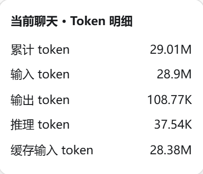
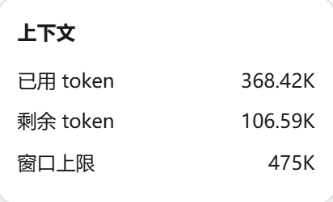

# Codex 用量监控

在 **Codex 模式和 ChatGPT Work 的输入框底部**显示当前聊天的 token、缓存命中率、上下文占用、账号剩余额度和重置倒计时。普通 ChatGPT 聊天模式自动隐藏。

目前支持 **Windows 10/11、简体中文界面**，适配 Windows 商店版 Codex。通过本地调试接口临时挂载界面，不改写客户端程序包。


| Token 明细 | 上下文明细 |
| --- | --- |
|  |  |

截图来自真实客户端，仅截取监控组件；数字是截图时的实际使用值。图中分别展示两种明细，实际操作时一次只展开一个。

## 能做什么

- 状态条保持单行：`2.35M tok　命中 91.3%　上下文 40%　额度 26%　重置 4d0h`。
- 点击 `数值 tok`，展开累计、输入、输出、推理、缓存输入明细。
- 点击“上下文”，展开已用 token、剩余 token 和窗口上限。
- 明细使用 K/M/B 缩写，悬停查看完整整数；点击外部或按 Esc 收起。
- 自动跟随当前可见聊天，避开隐藏标签页的缓存，不串用其他聊天数据。
- 将已有桌面 Codex 图标接入启动器；没有图标时创建一个。以后只点这个图标，客户端与监控一起启动。
- 客户端完全退出后，辅助进程约 12 秒内自动退出；没有注册开机常驻项、系统服务或计划任务。

## 环境要求

| 项目 | 要求 |
| --- | --- |
| 系统 | Windows 10/11；PowerShell 5.1 或更新版本 |
| 客户端 | 已安装并登录 Codex 桌面端；自动发现 `OpenAI.Codex` 商店安装包 |
| Node.js | 22 或更新版本，建议使用 LTS |
| Codex CLI | 可选。用于查询实时账号额度；优先使用 PATH 中的 CLI，其次尝试客户端内置 CLI |

**没有 npm 生产依赖，无需执行 `npm install`。** CLI 不可用或额度接口失败时，聊天统计仍能使用，额度退回日志快照或显示 `—`。没有本地会话日志的远程/云端聊天，token 项可能为 `—`。

## 安装

### 方式一：交给 AI Agent 自动配置

将以下提示词复制给能够运行本机命令的 AI Agent：

```text
请帮我下载并安装 Codex 用量监控：
https://github.com/Yang-goat/codex-usage-monitor

请先读取仓库 README.md、AGENTS.md 和 scripts/ 下的安装、启动、卸载脚本，再执行：
1. 检查 Windows、PowerShell、Node.js 22+ 和 Codex 桌面端。保留现有环境；缺少依赖时说明缺项和安装方式。
2. 将仓库 clone 到适合长期保留的独立目录，不用临时目录，不覆盖已有项目。已有此仓库时先检查本地改动再更新。
3. 不需要 npm install。运行 scripts/Start.ps1 -CheckOnly 做只读发现，随后执行 scripts/Install.ps1。
4. 优先接入已核实的桌面 Codex 图标。安装器会备份原快捷方式。若现有图标无法核实，不覆盖；改用未占用的 Codex 用量监控.lnk 作为 -ShortcutPath。
5. 客户端或 Node 无法自动发现时，用 -AppPath / -NodePath 指定真实路径；不要把 CLI codex.exe 当成桌面客户端。
6. 不强制结束或重启正在运行的 Codex。配置完成后告诉我正常退出全部客户端实例，再从已接入的图标重开。只在我同意后进行需要重启的实际界面检查。
7. 不读取、复制、打印或上传 auth.json、Token、完整聊天日志或会话数据库；不修改 Codex 全局配置或客户端程序包；不把调试端口暴露到局域网。
最后说明安装目录、使用哪个图标启动、如何卸载，以及实际执行和未执行的检查。
```

单独版本见 [AI Agent 安装提示词](docs/AI_AGENT_SETUP.md)。使用 Fork 时，将提示词中的仓库链接替换成对应地址。

### 方式二：手动安装

打开 PowerShell，将下面的目录替换成你准备长期保留代码的位置：

```powershell
git clone https://github.com/Yang-goat/codex-usage-monitor.git
cd codex-usage-monitor

# 只读检查安装路径和运行状态
powershell.exe -NoProfile -ExecutionPolicy Bypass -File .\scripts\Start.ps1 -CheckOnly

# 接入桌面 Codex 图标；没有该图标时创建
powershell.exe -NoProfile -ExecutionPolicy Bypass -File .\scripts\Install.ps1
```

`-ExecutionPolicy Bypass` 仅用于这次 PowerShell 进程，不修改系统执行策略。安装不需要管理员权限。

如果没有 Git，可以在仓库的 **Code → Download ZIP** 下载源码，解压到长期目录后执行上述两个脚本。

### 自定义路径与端口

```powershell
# 有同名图标且无法核实归属时，使用一个新入口
powershell.exe -NoProfile -ExecutionPolicy Bypass -File .\scripts\Install.ps1 `
  -ShortcutPath "$env:USERPROFILE\Desktop\Codex 用量监控.lnk"

# 非默认安装位置；填写你自己的桌面客户端路径
powershell.exe -NoProfile -ExecutionPolicy Bypass -File .\scripts\Install.ps1 `
  -AppPath "D:\Apps\Codex\ChatGPT.exe" `
  -NodePath "D:\Apps\Node\node.exe" `
  -Port 9349
```

也可使用 `-CliPath` 指定 CLI。参数保存在本地 `runtime/installation.json`，以后双击图标时自动读取。默认调试端口为 `127.0.0.1:9339`；遇到其他程序占用会停止，不会连接未知程序。

## 日常使用

1. 等已有任务完成后，**正常退出全部 Codex 实例**，包括仍在托盘运行的实例。
2. 双击安装时接入或创建的桌面图标。Codex 和辅助进程会一起启动，辅助进程没有单独窗口。
3. 打开 Codex 聊天或 ChatGPT Work。第一次没有已完成的模型调用时，部分统计可能为 `—`。
4. 点击 token 数值或“上下文”查看明细；额度与重置时间也有悬停信息。
5. 完全退出客户端后，辅助进程自动结束。只隐藏窗口到托盘时，客户端仍在运行，辅助进程也继续待命。

**启动联动针对安装器处理的 `.lnk` 图标。** 开始菜单中的内置应用项、旧的任务栏入口、协议链接或直接运行客户端可能不带调试参数。若已通过这些入口打开，请正常退出后从接入的图标重开。监控不会强制终止客户端。

## 统计口径

| 指标 | 含义 |
| --- | --- |
| 累计 token | 当前聊天最新 `total_token_usage.total_tokens`，是多轮调用累计量 |
| 输入 / 输出 | 当前聊天累计输入与输出 token |
| 推理 | 记录的累计推理输出，是输出的子项 |
| 缓存输入 | 命中的累计缓存输入，是输入的子项 |
| 缓存命中率 | 累计缓存输入 ÷ 累计输入 |
| 上下文占用 | 最近一次调用的 `last_token_usage.total_tokens / model_context_window` |
| 上下文剩余 | 窗口上限减去最近调用占用，最低为零 |
| 额度 | 账号共享额度窗口的剩余百分比，与单聊天累计 token 分开显示 |

统计随本地用量事件更新，不是逐字生成计数。K/M/B 分别表示千、百万、十亿，明细最多保留两位小数，悬停显示完整整数。

实时额度通过官方本地 `codex app-server` 的 `account/rateLimits/read` 大约每 60 秒读取，不发起模型推理或购买/消耗重置额度。查询失败时使用日志快照，超过两分钟标记“快照”。重置时间已过但尚未取得新额度时显示“待刷新”，不假定额度恢复。多个额度窗口通常并列展示，空间较窄时优先显示剩余额度最少的一项，悬停可查看全部。

## 更新与卸载

更新前先退出 Codex，保留 `runtime/`：它包含原快捷方式备份和安装记录。

```powershell
git status
git pull --ff-only
powershell.exe -NoProfile -ExecutionPolicy Bypass -File .\scripts\Install.ps1
```

有未提交修改时先自行处理，避免覆盖。保持安装目录位置不变；需要移动目录时，先在旧位置卸载，再移动和重新安装。

卸载：

```powershell
powershell.exe -NoProfile -ExecutionPolicy Bypass -File .\scripts\Uninstall.ps1
```

原有快捷方式会按备份字节恢复；安装器新建的快捷方式会被移除。若图标在安装后有其他修改，卸载器会停止覆盖并提示。聊天、登录和 Codex 配置不受影响。运行资料与备份保留在 `runtime/`，确认不再需要后可自行删除。

## 排查问题

| 情况 | 处理 |
| --- | --- |
| 桌面客户端找不到 | 使用 `Install.ps1 -AppPath` 指定 `ChatGPT.exe` 或 `Codex.exe`，不要指定 CLI |
| Node 找不到 | 安装 Node.js 22+ 后重开 PowerShell，或指定 `-NodePath` |
| 额度为 `—` / 快照 | CLI、登录或网络可能不可用；这不会阻止本地 token 统计 |
| 状态条没有出现 | 确认处于 Codex/Work、从接入的图标启动，并检查 `runtime/status.json` |
| 提示客户端已运行 | 正常退出所有窗口及托盘实例后重开 |
| 窄窗口隐藏状态条 | 底部空间不足时会暂时隐藏，扩大聊天区后重试 |
| 更新客户端后失效 | 客户端 DOM、日志与调试接口属于内部实现，可能需要适配 |
| 云端聊天没有数据 | 当前实现读取本机日志；缺少对应本地记录时保留未知值 |

`runtime/status.json` 的 `hiddenReason` 能区分没有代理输入框和空间不足等情况。提交 Issue 时说明系统、客户端版本、项目版本和现象即可；**不要上传 `runtime/`、登录文件或完整会话日志**。

## 隐私与边界

- 会话日志仅在本机读取，增量解析并保留数值统计，不复制聊天正文到项目。
- 只有本地 CLI 的额度查询需要访问账号服务；没有遥测、第三方统计服务或上传功能。
- 调试接口仅绑定回环地址。它允许本机程序控制客户端，请勿转发端口或开放到局域网。
- 不支持 macOS/Linux 桌面安装；目前只有简体中文界面。工作区或客户端禁用调试能力时无法挂载。
- 当前适配基于 Windows 商店客户端 `26.1027` 的输入框结构；不同版本需要实际核验。本仓库的源码测试不代表所有客户端版本均兼容。

## 开发

```powershell
npm.cmd test
npm.cmd run check:release
powershell.exe -NoProfile -ExecutionPolicy Bypass -File .\tests\scripts.test.ps1
npm.cmd run preview
```

预览页位于 `http://127.0.0.1:9841`，只使用模拟数据。支持切换 Codex、Work、普通聊天和深浅色，不读取真实聊天。界面源码在 `src/renderer.js`；每次改变注入界面时同时更新渲染器版本，运行中的新版辅助进程会检测源文件变化。

```text
src/                   会话统计、额度查询、调试连接与状态条
scripts/               安装、启动、恢复和路径发现
tests/                 使用模拟数据的测试
tools/                 预览与发布检查
docs/                  AI Agent 提示词与示意图
runtime/               本机运行资料与原图标备份（忽略上传）
```

## 参考与许可

参考了 [Codex-Monitor](https://github.com/KevinKE93/Codex-Monitor) 的临时 DOM 注入思路和 [Codex Token Overlay](https://github.com/soleillevant0125/codex-token-overlay) 的本地日志统计思路；本项目实现独立编写。额度接口见 [OpenAI App Server 文档](https://learn.chatgpt.com/docs/app-server)。

[MIT License](LICENSE)。这是社区项目，与 OpenAI 无隶属关系。
