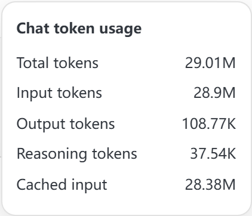
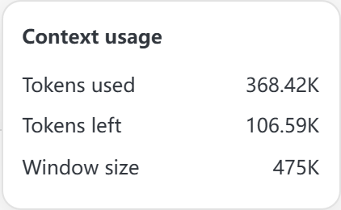
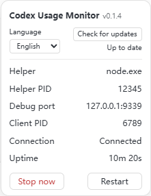

<h1 align="center">Codex Usage Monitor</h1>

<p align="center">
  <a href="README.zh-CN.md">简体中文</a> · <a href="README.md"><strong>English</strong></a>
</p>

<p align="center">
  <a href="https://github.com/Yang-goat/codex-usage-monitor/actions/workflows/check.yml"></a>
  <a href="https://github.com/Yang-goat/codex-usage-monitor/releases/latest"></a>
  <a href="LICENSE"></a>
</p>

<p align="center">
  See token usage, context usage, and remaining account quota below the main chat composer in Codex and ChatGPT Work on Windows.
</p>

<p align="center">
  <strong><a href="https://github.com/Yang-goat/codex-usage-monitor/releases/latest">Download for Windows</a></strong> · <a href="#quick-start">Quick start</a> · <a href="docs/AI_AGENT_SETUP.md">Install with an AI agent</a> · <a href="https://github.com/Yang-goat/codex-usage-monitor/issues/new/choose">Report an issue</a>
</p>

<p align="center">
  
</p>

## Usage at a glance

- **Tokens and cache** — See cumulative usage and the input cache hit rate for the current chat. Click the token count for input, output, reasoning, and cached input.
- **Context** — See tokens used, tokens remaining, and the window limit for the most recent model call.
- **Account quota** — See the percentage remaining in shared quota windows and the countdown to each reset. The monitor can use a local log snapshot when live quota is unavailable.
- **Compact settings** — The gear on the right opens language, version, update status, and helper controls. Switch between Simplified Chinese and English at any time. Your choice is saved locally.

| Token details | Context details | Settings preview |
| --- | --- | --- |
|  |  |  |

Both languages show the same sample data in the local preview of the current source. See the [latest release notes](https://github.com/Yang-goat/codex-usage-monitor/releases/latest) for features in the stable version.

### Taskbar icons

The launcher restores blank taskbar icons and maintains them when desktop windows are recreated. Installation caches the shortcut icon under `runtime/icons/` so Store upgrades do not invalidate its file path. One hidden icon helper runs per desktop process and exits with it. This applies when using the monitor shortcut; Windows sign-in startup settings are unchanged.

## Requirements

| Item | Requirement |
| --- | --- |
| OS | Windows 10 or 11 with PowerShell 5.1 or later |
| Desktop app | Install and sign in to Codex Desktop. The installer automatically discovers the `OpenAI.Codex` Store package. |
| Node.js | Version 22 or later. An LTS version is recommended. |
| Codex CLI | Optional for live quota. The monitor tries the CLI on PATH first, then the CLI bundled with the desktop app. |

**There are no production npm dependencies, so you can skip `npm install`.** If the CLI or quota endpoint is unavailable, chat statistics still work and quota falls back to a log snapshot or displays `—`. Token statistics can show `—` for remote or cloud chats without local session logs.

## Quick start

To have an agent configure the monitor, copy the [AI agent installation prompt](docs/AI_AGENT_SETUP.md).

Download the Windows ZIP and `SHA256SUMS.txt` from [Releases](https://github.com/Yang-goat/codex-usage-monitor/releases/latest). Verify the downloaded ZIP in PowerShell.

```powershell
Get-FileHash -Algorithm SHA256 .\codex-usage-monitor-v0.1.6-windows.zip
Get-Content .\SHA256SUMS.txt
```

After the hashes match, extract the ZIP to a directory you plan to keep. Run these commands from the extracted project directory.

```powershell
# Check the installation paths and runtime status without making changes.
powershell.exe -NoProfile -ExecutionPolicy Bypass -File .\scripts\Start.ps1 -CheckOnly

# Link the desktop Codex shortcut, or create one if it is missing.
powershell.exe -NoProfile -ExecutionPolicy Bypass -File .\scripts\Install.ps1
```

`-ExecutionPolicy Bypass` applies to this PowerShell process only. Installation requires no administrator privileges.

You can also get the source with Git and run the same two scripts.

```powershell
git clone https://github.com/Yang-goat/codex-usage-monitor.git
cd codex-usage-monitor
```

The release ZIP can be installed without Git.

### Custom paths and ports

```powershell
# Use a new shortcut if the existing shortcut cannot be verified.
powershell.exe -NoProfile -ExecutionPolicy Bypass -File .\scripts\Install.ps1 `
  -ShortcutPath "$env:USERPROFILE\Desktop\Codex Usage Monitor.lnk"

# For non-default installations, supply your actual desktop app and Node paths.
powershell.exe -NoProfile -ExecutionPolicy Bypass -File .\scripts\Install.ps1 `
  -AppPath "D:\Apps\Codex\ChatGPT.exe" `
  -NodePath "D:\Apps\Node\node.exe" `
  -Port 9349
```

Use `-CliPath` to specify the CLI if needed. The installer saves these options in the local `runtime/installation.json` and reads them when you double-click the shortcut. The default debug endpoint is `127.0.0.1:9339`. If another application occupies the port, startup stops.

## Everyday use

1. Wait for current tasks to finish, then **fully quit all Codex instances**, including those running in the system tray.
2. Double-click the desktop shortcut that the installer linked or created. Codex and the helper start together, and the helper runs without a separate window.
3. Open Codex chat or ChatGPT Work. Some statistics may show `—` until the first model call completes.
4. Click the token count or **Ctx** for details. Hover over the quota or reset time for more information.
5. Open the gear and choose Simplified Chinese or English under **Language**. The helper checks for updates on startup, and you can check again manually. When a newer release has a verifiable Windows package, the button changes to **Auto-update**. Click it to download and install, or open the corresponding release page.
6. The helper stops automatically when the client exits completely. If you hide the client in the tray, the helper continues running.

**Automatic startup uses the `.lnk` shortcut configured by the installer.** The built-in Start menu item, an old taskbar shortcut, a protocol link, or a direct launch may omit the debug arguments. If you opened Codex through one of these routes, quit normally and reopen it from the configured shortcut. The monitor never force-quits the client.

## How usage is measured

| Metric | Meaning |
| --- | --- |
| Cumulative tokens | The latest `total_token_usage.total_tokens` in the current chat, accumulated across calls |
| Input / output | Cumulative input and output tokens in the current chat |
| Reasoning | Recorded cumulative reasoning tokens, included in output tokens |
| Cached input | Cumulative input tokens served from the cache, included in input tokens |
| Cache hit rate | Cumulative cached input divided by cumulative input |
| Context usage | `last_token_usage.total_tokens / model_context_window` for the latest call |
| Context remaining | Window limit minus usage from the latest call, with a minimum of zero |
| Quota | Remaining percentage in the shared account quota window, shown separately from chat token usage |

Statistics update with local usage events as model calls are recorded. K, M, and B stand for thousands, millions, and billions. Details show up to two decimal places, and hovering shows the full integer.

The monitor reads live quota from `account/rateLimits/read` in the official local `codex app-server` about once per minute. The query runs without model inference, purchases, or quota consumption. If it fails, the monitor uses a log snapshot and labels it **Stale** after two minutes. Once a reset time passes, the monitor shows **Pending** until new quota arrives. Multiple quota windows usually appear side by side. In narrow layouts, the window with the lowest remaining percentage takes priority, and hovering reveals all windows.

## Updating and uninstalling

In versions with auto-update, **Auto-update** verifies the SHA-256 of the official GitHub release package and restarts only the monitor helper. The switch is saved after the new helper starts, and a startup failure restores the previous version. The update is extracted to `runtime/updates/`. The desktop shortcut, Git checkout, and language setting are preserved.

Before a manual update, quit Codex and keep `runtime/`. If you installed with Git, update from the existing directory.

```powershell
git status
git pull --ff-only
powershell.exe -NoProfile -ExecutionPolicy Bypass -File .\scripts\Install.ps1
```

Resolve any uncommitted changes first to avoid overwriting them. Keep the installation at its existing path. If you need to move it, uninstall from the old directory before moving and reinstalling.

If you installed from a ZIP, run the uninstaller from the old directory, extract the new release to a permanent directory, and reinstall. Keep the old directory's backups until you verify the update.

To uninstall, run the following command.

```powershell
powershell.exe -NoProfile -ExecutionPolicy Bypass -File .\scripts\Uninstall.ps1
```

The installer restores the original shortcut byte for byte or removes the shortcut it created. If the shortcut was edited after installation, the uninstaller stops and reports the conflict. It preserves chats, sign-in state, and Codex configuration. Runtime files and backups remain in `runtime/` for you to remove when you no longer need them.

## Troubleshooting

| Symptom | What to do |
| --- | --- |
| Desktop app cannot be found | Use `Install.ps1 -AppPath` with the desktop `ChatGPT.exe` or `Codex.exe` path. |
| Node.js cannot be found | Install Node.js 22+ and reopen PowerShell, or specify `-NodePath`. |
| Quota shows `—` or a snapshot | Check the CLI, sign-in, and network. Local token statistics can still work. |
| The monitor is missing | Open Codex or Work from the configured shortcut and check `runtime/status.json`. |
| The client is already running | Quit all windows and tray instances normally before reopening. |
| The monitor disappears in a narrow window | Make the chat area wider to give the composer footer more room. |
| The monitor stops working after a client update | Changes to the client DOM, logs, or debug interface may require a compatibility update. |
| Cloud chats show no data | The monitor reads local logs and shows unknown values when a local record is missing. |

The `hiddenReason` field in `runtime/status.json` distinguishes a missing agent composer from a lack of space and other cases. When filing an issue, include the OS, client version, monitor version, and what happened. **Keep `runtime/`, sign-in files, and complete session logs private.**

## Privacy and compatibility

- Session logs are read locally and parsed incrementally. The monitor retains numeric statistics and keeps chat text out of the project.
- The local CLI contacts the account service for quota. The helper requests public release information from GitHub at startup and during manual update checks. Both features operate without telemetry or third-party analytics.
- The debug interface binds only to loopback. Local programs can use it to control the client. Keep the port private and avoid forwarding it.
- Desktop installation supports Windows only. Installer and launcher messages are in Simplified Chinese. The monitor cannot attach if the workspace or client disables debugging.
- The adapter targets the composer structure of Windows Store client `26.1027`. Other client versions require real-client verification. Repository source tests cover simulated cases, so compatibility varies by client version.

## Development and contributing

Use the [issue form](https://github.com/Yang-goat/codex-usage-monitor/issues/new/choose) to share your Windows, Codex, and monitor versions and the steps to reproduce the issue. Remove private data before sharing screenshots.

```powershell
npm.cmd test
npm.cmd run check:release
powershell.exe -NoProfile -ExecutionPolicy Bypass -File .\tests\scripts.test.ps1
npm.cmd run preview
```

Commit all changes before running `npm.cmd run build:release`. The build script uses committed Git source to create a Windows ZIP, `SHA256SUMS.txt`, and a local build manifest in `dist/release/v<version>/`. The ZIP contains runtime source, installation and startup scripts, `package.json`, the license, and the [installation guide](INSTALL.md). See the [v0.1.6 notes](docs/releases/v0.1.6.md) and [changelog](CHANGELOG.md).

The preview at `http://127.0.0.1:9841` uses sample data. Switch between Codex, Work, and regular chat or toggle light and dark themes. The UI source is in `src/renderer.js`. Update the renderer version with each change to the injected UI so a running helper can detect source changes.

```text
src/                   Session metrics, quota queries, debug connection, and monitor
scripts/               Installation, startup, restoration, and path discovery
tests/                 Tests using simulated data
tools/                 Preview and release checks
docs/                  AI agent prompts and screenshots
runtime/               Local runtime data and original shortcut backups (ignored by Git)
```

The standalone browser regression helper is `tools/check-dot-surface.mjs`. In an existing Playwright environment, provide an isolated `page`, the preview HTML, and the renderer source to check exclusion of the main-window Dot container and the quick-window route, and recovery after returning to regular chat. Optionally pass the previous renderer to reproduce a problem and verify hot replacement. The check uses simulated pages.

Use `tools/check-main-only.mjs` on an isolated Playwright page to verify focus changes, side-container exclusion, the source of usage statistics, and handling of a missing main chat ID. Side chats can be temporary branches without local logs. The monitor currently shows the main chat's tokens and context alongside shared account quota.

## Credits and license

[Codex-Monitor](https://github.com/KevinKE93/Codex-Monitor) inspired the temporary DOM injection, and [Codex Token Overlay](https://github.com/soleillevant0125/codex-token-overlay) inspired the local log statistics. This project has an independent implementation. See the [OpenAI App Server documentation](https://learn.chatgpt.com/docs/app-server) for the quota interface.

[MIT License](LICENSE). This community project is independent of OpenAI.
